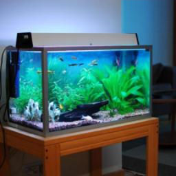
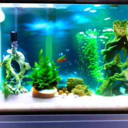
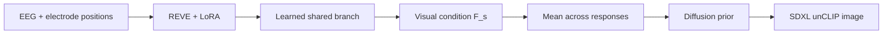
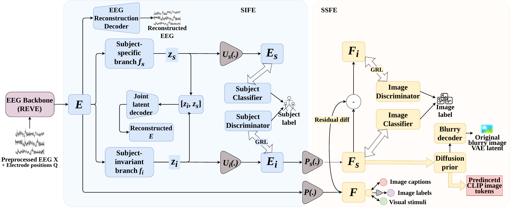
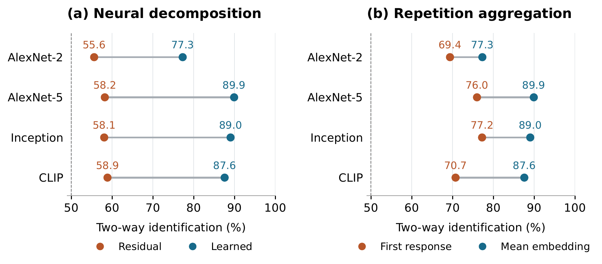
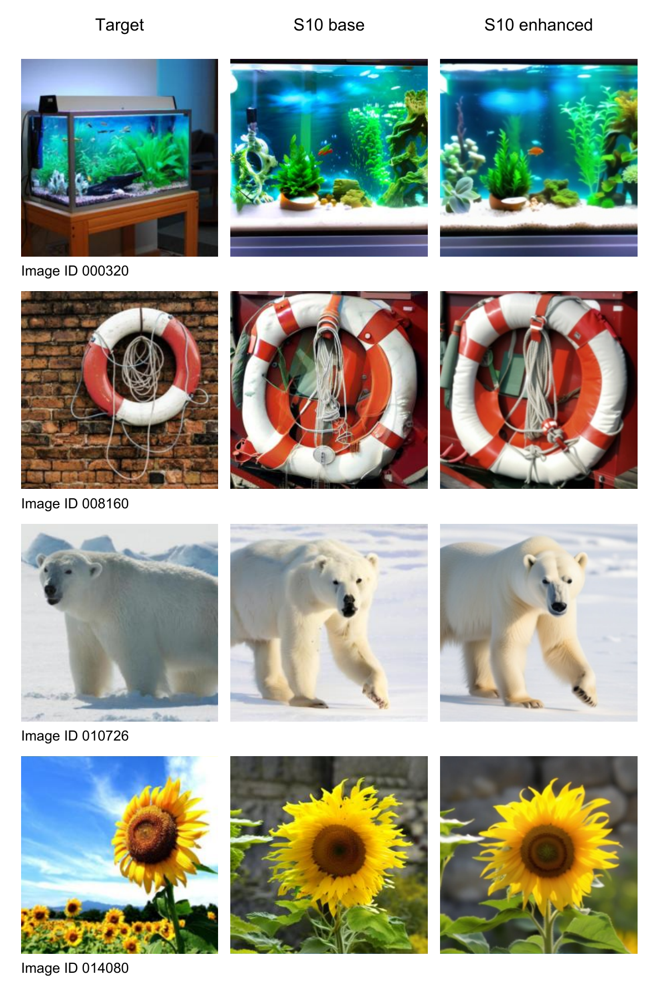
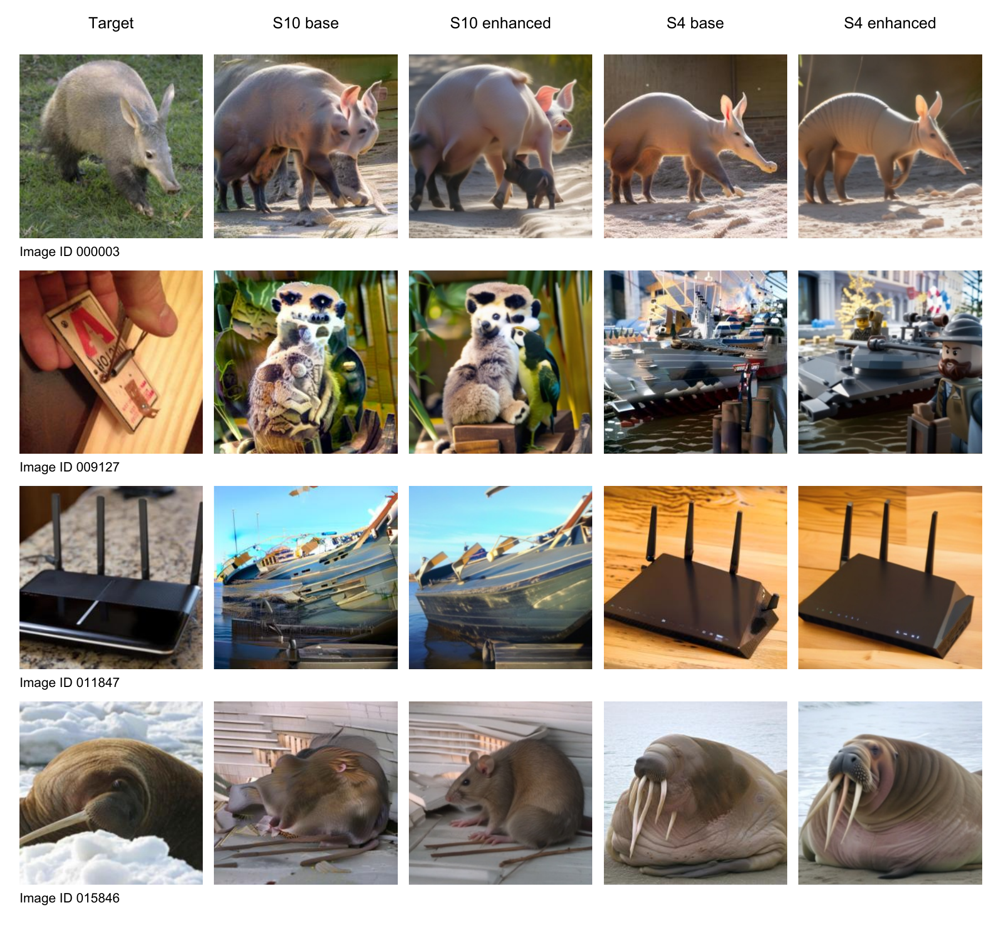

<h1 align="center">Cross-Subject EEG-to-Image Reconstruction</h1>

<p align="center">
  <strong>Reconstructing visual content from EEG for a participant excluded from training.</strong><br>
  Master's thesis · Sapienza University of Rome · Lorenzo Soannini
</p>

<p align="center">
  <a href="#my-contribution">My contribution</a> ·
  <a href="#how-it-works">Method</a> ·
  <a href="#thesis-results">Results</a> ·
  <a href="#explore-the-code">Code &amp; setup</a>
</p>

<table align="center">
  <tr>
    <th colspan="2">Aquarium</th>
    <th colspan="2">Polar bear</th>
  </tr>
  <tr>
    <td align="center">Viewed image</td>
    <td align="center">EEG reconstruction</td>
    <td align="center">Viewed image</td>
    <td align="center">EEG reconstruction</td>
  </tr>
  <tr>
    <td></td>
    <td></td>
    <td></td>
    <td></td>
  </tr>
</table>

*Selected base reconstructions from the thesis, heldout subject 10. Viewpoint and fine details can differ; selected examples do not estimate a success rate.*

<table>
  <tr>
    <td align="center"><strong>87.60%</strong><br>CLIP two-way identification<br><sub>1,654 targets · heldout subject 10</sub></td>
    <td align="center"><strong>89.38%</strong><br>Inception two-way identification<br><sub>1,654 targets · heldout subject 10</sub></td>
    <td align="center"><strong>+28.71 pp</strong><br>CLIP improvement over residual model<br><sub>Controlled 100-target comparison</sub></td>
  </tr>
</table>

My thesis adapts [ZEBRA](https://github.com/xmed-lab/ZEBRA) from fMRI to EEG, using REVE and a learned shared/private representation. The task combines an unseen participant with unseen photographs of **familiar object categories**. Subjects 1–9 are the sources; subject 10 is held out in the reported experiment. Identification scores are pairwise comparisons, with a nominal 50% chance reference—not top-1 classification accuracy.

## My contribution

- **EEG-to-vision adaptation:** integrated THINGS-EEG2, REVE with LoRA, and a learned token resampler to connect EEG features to the image generator's visual interface.
- **Learned latent decomposition:** replaced the fixed neural residual with independently learned shared/private branches, supported by joint reconstruction and separation objectives.
- **Experimental evaluation:** compared residual and learned decomposition, single-response and mean-embedding inference, and an adapted ATM baseline using eight reconstruction metrics.

**Technical stack:** Python · PyTorch · Transformers · LoRA · OpenCLIP · diffusion priors · SDXL unCLIP · BLIP-2 · W&B

## How it works



The model learns shared and subject-related branches from the complete EEG representation. Only the shared branch's semantic projection, `F_s`, conditions generation. Repeated responses are encoded separately and their embeddings are averaged **before** prior sampling. An optional BLIP-2 caption of the generated image guides refinement.

<details>
<summary><strong>Technical detail: decomposition, supervision and full architecture</strong></summary>

The proposed model learns both `E_i` and `E_s` from `E`, replacing the neural subtraction constraint `E_s = E − E_i`. Joint latent reconstruction, covariance and variance-floor losses support preservation and separation. The visual residual `F_i = F − F_s` remains part of training.

The EEG interface uses 63 channels, REVE width 1,216, shared/private bottlenecks of 512/256 and a resampler producing 256 visual tokens. Subject heads and the private branch support training; inference loads the shared route and prior. Ground-truth photographs and category labels are not generator inputs.



*Architecture from the thesis. The joint decoder reconstructs the EEG representation; the blurry decoder provides auxiliary image-latent supervision. The resampler is included in the projection paths.*

[Protocol and objectives](docs/PROTOCOL.md) · [Model implementation](model/network.py)

</details>

## Thesis results

The full-vocabulary experiment evaluates **1,654 photographs, one per category**, for subject 10. On the matched 100-target development set, both learned decomposition and response averaging improve all eight reported metrics for base and enhanced outputs.



| Experiment | Base CLIP two-way identification | Evaluation set |
|---|---:|---|
| Residual → learned decomposition | 58.87% → **87.58%** | Same 100 targets |
| First response → mean embedding | 70.73% → **87.58%** | Same 100 targets; model fixed |
| Full-vocabulary learned model | **87.60%** | 1,654 targets |

The decomposition comparison measures the combined architecture and regularization change. The adapted [ATM](https://github.com/ncclab-sustech/EEG_Image_decode) comparison favours the proposed model on feature-based correspondence; ATM encoder-only generation has higher PixCorr and SSIM. Refinement raises SSIM in the full-vocabulary experiment while reducing several semantic identification scores.

**[All eight metrics and baseline comparisons →](docs/RESULTS.md)** · [Full-precision CSV tables](results/)

<details>
<summary><strong>More examples: base and refined reconstructions</strong></summary>

<p align="center">
  
</p>

*Aquarium, lifebuoy, polar bear and sunflower. Refinement uses captions derived from the generated images.*

</details>

<details>
<summary><strong>Failure cases and limits</strong></summary>



*Columns: target, subject-10 base/enhanced, subject-4 base/enhanced. Errors include altered anatomy, router-to-boat substitution and a walrus reconstructed as a rodent. Refinement can preserve an incorrect interpretation.*

The reported transfer result concerns one heldout participant. Broader participant-level generalization requires additional folds. The main results aggregate repeated responses; they are not single-trial scores. Identification candidates come from different categories, so these scores do not establish fine-grained within-category photographic discrimination. Selected examples and aggregate scores do not provide confidence intervals.

</details>

## Explore the code

| Component | Implementation |
|---|---|
| Image partitions and source-only normalization | [Data protocol](data_loader/protocol.py) |
| REVE adaptation and learned shared/private branches | [Encoder](model/encoder.py) · [Decomposition](model/decomposition.py) |
| Pretraining and semantic prior conditioning | [Training](train.py) · [Model](model/network.py) |
| Repeated-response aggregation and generation | [Aggregation](model/aggregation.py) · [Reconstruction](eval/reconstruct.py) |
| Paired image evaluation | [Metrics](eval/eval_metrics.py) |

```bash
python -m venv .venv
source .venv/bin/activate
python -m pip install -r requirements.txt
python -m unittest discover -s tests -v
```

**17 component tests passed.** They cover split integrity, source-only statistics, semantic conditioning, gradients, aggregation, sampling and image/metric contracts. Full training and generation require CUDA, THINGS-EEG2 and external pretrained weights.

[Setup and training guide](docs/RUNNING.md) · [Configuration](config.json) · [Validation report](docs/VALIDATION.md)

**Provenance:** the figures and scores are from the completed thesis and defence. This accompanying implementation was consolidated for publication, including documented partition, normalization and prior-routing changes that require compatible retraining. The published checkout has not been rerun to reproduce the historical scores. [Results sources](docs/result_sources.json)

---

**Lorenzo Soannini** · Master's Degree in Engineering in Computer Science, **Sapienza University of Rome**<br>
*EEG-to-Image Reconstruction through Multimodal Visual–Semantic Alignment* · Supervisor: Prof. Danilo Comminiello<br>
[Third-party components and attribution](THIRD_PARTY.md)
