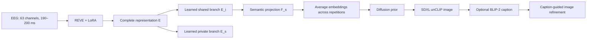

# Cross-subject EEG-to-image reconstruction

An EEG adaptation of ZEBRA using REVE, LoRA and learned shared/private latent branches. The image generator receives semantic features from the shared EEG branch. This repository contains a focused implementation of the final study protocol, with the additional shared-branch image-alignment loss retained during pretraining.



The private branch, subject heads and joint latent decoder provide training supervision. Inference loads only the EEG encoder, shared branch, semantic projection/resampler and prior. The visual residual `F_i = F − F_s` remains part of downstream training; there is no neural subtraction constraint `E_s = E − E_i`.

## Protocol

- Subjects 1–9 provide training and validation EEG. Subject 10 is reserved for final evaluation; subject 4 is an optional source-subject reference.
- Training and evaluation share object categories. Within every category, eight photographs are assigned to training, one to validation and a different one to evaluation. Image assignments are identical across subjects and repetitions.
- Development uses 100 categories selected with seed 42. The final configuration trains separately on all 1,654 categories. Change `categories` in a separate configuration and use a fresh output directory for each run. Prepare a separate index/statistics directory with `prepare_protocol.py --categories 100` for development.
- Continuous EEG is resampled to 200 Hz and high-pass filtered at 0.5 Hz. Early windows contain 38–40 real samples and are right-padded to 200 samples after normalization and clipping.
- Per-channel normalization pools valid time samples from source-subject training windows only. Population standard deviation uses a floor of `1e-6`. The saved transform is reused unchanged for validation and evaluation.
- Pretraining aligns both `F` and `F_s` to image tokens. Downstream also aligns both representations, while the prior is conditioned exclusively on `F_s`.
- Repeated responses are encoded individually; their `F_s` embeddings are averaged before prior sampling. Ground-truth images and category labels are not generator inputs.

This is cross-subject reconstruction of unseen photographs from seen categories. The native 200-category THINGS-EEG2 test split is not this study's final evaluation set. The full-vocabulary image partition contains 13,232 training, 1,654 validation and 1,654 evaluation photographs; retained EEG trial counts additionally depend on window eligibility.

## Setup

Use Python 3.10 or newer and a CUDA-enabled PyTorch installation for full training and generation. Create an isolated environment, install the PyTorch build appropriate for your CUDA installation, then install the remaining dependencies:

```bash
python -m venv .venv
source .venv/bin/activate
pip install -r requirements.txt
```

The requirements list names the runtime dependencies; it is not a verified lockfile for a complete GPU run. Core CPU tests have been run with Python 3.12 and PyTorch 2.5.0. The generation engine additionally requires PyTorch Lightning and the external model weights.

Download THINGS-EEG2 from its upstream distribution and obtain the REVE and generator weights separately. Dataset files, model weights, local logs and generated outputs are excluded from this repository. See [third-party components](../THIRD_PARTY.md) for upstream projects.

Expected local files include:

```text
data/THINGS-EEG2/
  raw-eeg/sub-XX/ses-YY/raw_eeg_training.npy
  raw-eeg/sub-XX/ses-YY/raw_eeg_test.npy
  image_metadata.npy
  imgs/training_images/...
pretrained_weights/
  coco_tokens_avg_proj.pth
  sd_image_var_autoenc.pth
  unclip6_epoch0_step110000.ckpt
  zavychromaxl_v30.safetensors
```

REVE is loaded from `brain-bzh/reve-large` through Transformers. Obtain model access and cache the weights before an offline run. The architecture requires the channel-position matrix generated by the indexing tool.

## Prepare data

Run commands from the repository root. The initial index is an intermediate recording/image catalogue. `prepare_protocol.py` creates the definitive study index without overwriting the input index.

```bash
python tools/downsample_things_eeg2_raw.py --root data/THINGS-EEG2 --execute
python tools/highpass.py \
  --input data/THINGS-EEG2/canonical_200hz \
  --output data/THINGS-EEG2/canonical_200hz_hp05
python tools/build_things_eeg2_index.py \
  --root data/THINGS-EEG2 \
  --canonical-root data/THINGS-EEG2/canonical_200hz_hp05 \
  --output-dir data/THINGS-EEG2/recording_index --execute
python tools/prepare_protocol.py \
  --root data/THINGS-EEG2 \
  --input-index data/THINGS-EEG2/recording_index \
  --output-index data/THINGS-EEG2/portfolio_index \
  --statistics data/THINGS-EEG2/source_statistics
python tools/cache_things_eeg2_openclip.py \
  --root data/THINGS-EEG2 \
  --index-dir data/THINGS-EEG2/portfolio_index \
  --execute
```

The cache tool supports resuming a partially built image-token cache. Computing a cache for an evaluation photograph does not expose it to training: training loaders select only their own split, and inference never reads cached evaluation tokens. [Reference image assignments](reference_image_splits.json) store the deterministic full-vocabulary split IDs.

## Train

Edit the data, index, statistics and weights paths in `config.json`. Pretraining saves epoch 50 for downstream initialization; both stages use the configured 100-epoch budget. Downstream freezes the pretrained EEG encoder and decomposition, following the inherited ZEBRA stage convention, and learns the visual/generative interface.

```bash
python train.py pretrain --config config.json
python train.py downstream --config config.json \
  --pretrain-checkpoint output/pretrain/epoch_050.pth
```

Optional W&B logging is enabled with `--wandb-project PROJECT`. Logged losses are measured values; separately named `weighted/` entries show their actual objective contributions. No cosmetic scaling or synthetic curve perturbation is implemented. Validation uses source data only. Final reconstruction uses the last downstream checkpoint.

Each run records its configuration, subject/image protocol, retained trial counts, software versions and normalization/index hashes. Checkpoints from incompatible partitions or normalization are rejected. Use a fresh output directory for a different experiment.

## Reconstruct and evaluate

```bash
bash run.sh config.json output/downstream/last.pth output/evaluation_s10 10
```

The runner generates base images, computes metrics, captions the generated images, refines them and evaluates the refined images. To generate base images only:

```bash
python eval/reconstruct.py --config config.json \
  --checkpoint output/downstream/last.pth \
  --output-dir output/evaluation_s10 --subject 10
python eval/metrics.py --input-dir output/evaluation_s10 --mode base
```

Outputs include aligned `all_recons.pt` / `all_gts.pt`, `samples.csv`, metadata and metric JSON files. Enhancement adds `all_enhanced_recons.pt`. Metadata records retained trial rows and repetition counts. Generation requires a fresh output directory and fails on non-finite values rather than replacing them with arbitrary pixels.

The eight metrics retain the study's preprocessing and definitions: PixCorr, grayscale SSIM, AlexNet-2/5, Inception and CLIP two-way identification, plus EfficientNet and SwAV correlation distances. Two-way identification is a pairwise comparison score, not top-1 retrieval accuracy. Base and enhanced results are reported separately.

## Validation and provenance

```bash
python -m unittest discover -s tests -v
```

Tests exercise source-only statistics, partition integrity, normalization provenance, semantic prior conditioning, latent gradients, LoRA gating, repeated-response aggregation and corrected DDIM sampling. See [validation results](VALIDATION.md) and [implementation decisions](PROTOCOL.md).

This portfolio refactor changes the historical data partition, normalization and incorrect full-representation prior routes. Existing experiment checkpoints cannot become compliant through a variable rename; fresh training is required. Historical thesis scores are not presented as reproduced results of this refactor. Full CUDA training, image generation and metric-model downloads have not been executed as part of preparing this repository.
